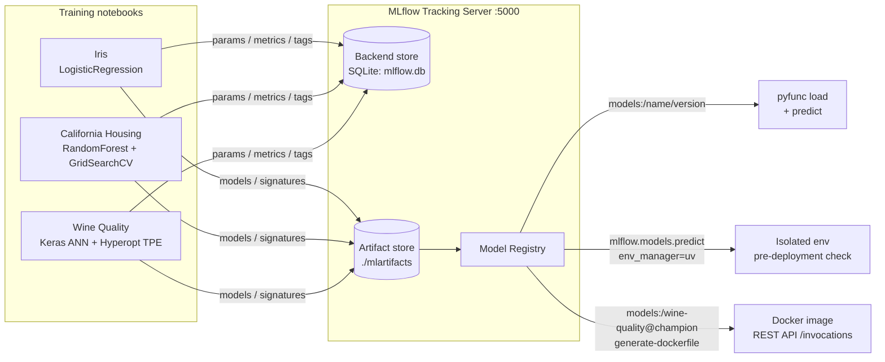
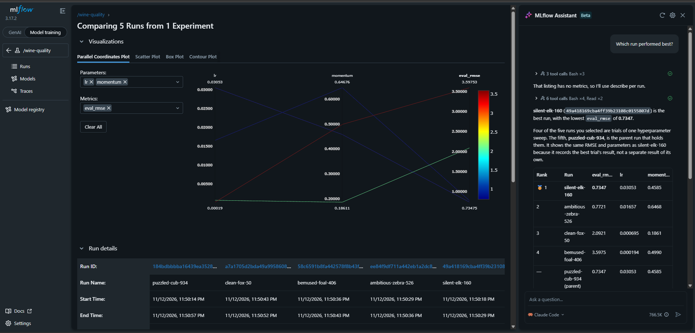
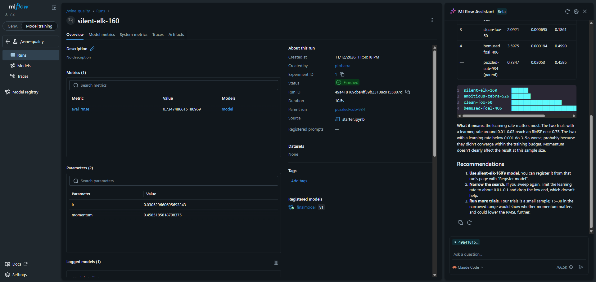
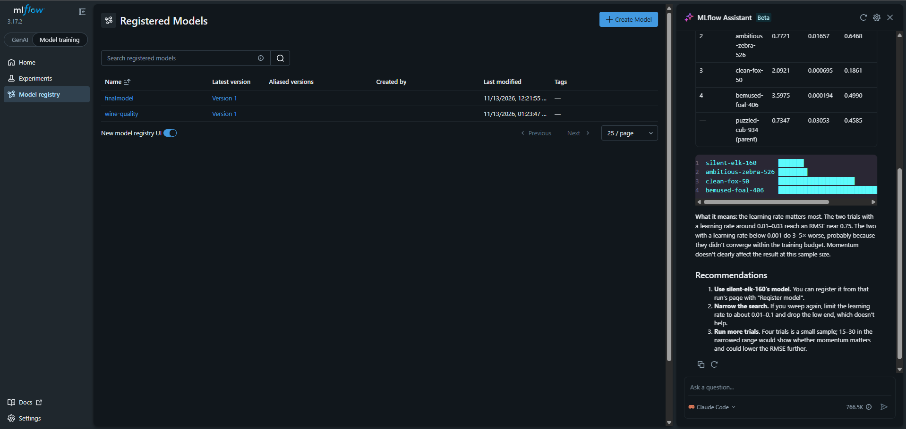

# MLflow Experiment Tracking Lab

[](https://www.python.org/)
[](https://mlflow.org/)
[](https://www.tensorflow.org/)
[](https://docs.astral.sh/uv/)
[](LICENSE)

This repo takes three models through the same MLflow lifecycle: **train → track → tune → register → validate before serving → load for inference**. The models are a scikit-learn classifier, a random forest regressor and a TensorFlow/Keras neural network. All of them use one MLflow tracking server with a SQLite backend store and a local artifact store.

The aim is to show the engineering around a model, not just the model: reproducible environments, lineage from every run to its registered version, typed model signatures, and a check that a model can serve predictions *before* it is deployed.

---

## What this project demonstrates

| Capability | Where | How |
|---|---|---|
| **Experiment tracking** | all notebooks | Params, metrics, tags and artifacts are logged to one MLflow server. Runs are compared with `mlflow.search_runs`, and the SQLite backend store is also queried directly. |
| **Hyperparameter tuning** | `1-MLproject/housepredict.ipynb` | `GridSearchCV` over 24 random-forest configurations (3-fold CV, 72 fits). |
| **Bayesian optimisation** | `2-DLMLFLOW/starter.ipynb` | Hyperopt TPE search over learning rate (log-uniform) and momentum. Each trial is logged as a **nested MLflow run** under one parent run. |
| **Model registry** | `gettingstarted`, `housepredict`, `starter` | Models are registered and versioned, then loaded back by registry URI (`models:/<name>/<version>`). |
| **Model signatures** | all models | `infer_signature` attaches an input/output schema, so the served model rejects inputs that don't match. |
| **Pre-deployment validation** | `gettingstarted`, `starter` | `mlflow.models.predict` with `env_manager="uv"` rebuilds a clean environment from the model's logged requirements and runs predictions there, as a deployment would. |
| **Framework-agnostic inference** | all models | Every model is loaded through the `pyfunc` interface, so serving code doesn't depend on whether the model is scikit-learn or Keras. |
| **Model serving** | `serving/wine-quality/` | The `@champion` model is packaged into a Docker image with `mlflow models generate-dockerfile` and served as a REST API (nginx + uvicorn). The predictions it returns were checked against the registered model's local predictions and matched exactly. |
| **GPU training** | `2-DLMLFLOW/starter.ipynb` | TensorFlow with CUDA (`tensorflow[and-cuda]`), with XLA compilation, on an NVIDIA GPU. |
| **Reproducible environment** | `pyproject.toml`, `uv.lock` | Dependencies are pinned in a lockfile, with Python 3.12 pinned in `.python-version`. |

---

## Architecture



---

## Projects and results

### 1. MLflow fundamentals: Iris classification
[`1-MLproject/gettingstarted.ipynb`](1-MLproject/gettingstarted.ipynb)

- Trains a logistic regression model and compares runs that use different solvers (`lbfgs`, `newton-cg`) in one experiment.
- Logs the model with a signature and an input example, and registers it as `tracking-quickstart` (several versions).
- Builds a serving payload from the input example and validates it against the model. This is done twice: once in the current environment and once in a fresh **uv-built environment** made from the model's logged requirements.
- Loads the model back from the registry by URI and checks its predictions against the true labels.

**Result:** 96.7% test accuracy.

### 2. Hyperparameter tuning: California house prices
[`1-MLproject/housepredict.ipynb`](1-MLproject/housepredict.ipynb)

- Runs a grid search over `n_estimators`, `max_depth`, `min_samples_split` and `min_samples_leaf`.
- Logs the best configuration and its test MSE to MLflow.
- Registers the best estimator as `Best Randomforest Model`, and only when the tracking URI points at a server that supports the registry.
- Sets an explicit allow-list of trusted types (`sklearn.tree._tree.Tree`) for loading the model safely.

**Result:** test MSE 0.247 (RMSE ≈ 0.50, in units of $100k). Best parameters: `n_estimators=200`, `max_depth=None`, `min_samples_split=2`, `min_samples_leaf=1`.

### 3. Deep learning with Bayesian optimisation: wine quality
[`2-DLMLFLOW/starter.ipynb`](2-DLMLFLOW/starter.ipynb)

- Splits the data into train, validation and test sets. The test set is held out until the final evaluation.
- The Keras model has a `Normalization` layer fitted to the training statistics, so preprocessing is saved **inside the model artifact** and can't drift away from it at serving time.
- Runs a Hyperopt TPE search over the learning rate and momentum of an SGD optimiser. Every trial is a nested MLflow run with its own logged model.
- Logs the best trial to the parent run, checks it on the held-out test set, and registers it as `wine-quality`.
- Shows three ways to run inference: `validate_serving_input`, `mlflow.models.predict`, and `pyfunc.load_model`.

**Result:** best validation RMSE 0.735 and **held-out test RMSE 0.746** on the 3–9 quality scale. The search is kept small on purpose (4 evaluations × 3 epochs) so it runs on a 4 GB GPU. It is meant to show the workflow, not to set a benchmark.

**Comparing the Hyperopt trials.** The parallel coordinates plot shows how learning rate and momentum relate to validation RMSE across the parent run and its four nested trials. Learning rate has the biggest effect: trials with `lr` ≈ 0.01–0.03 reach RMSE ≈ 0.75, while trials with `lr` < 0.001 do 3–5× worse within the training budget.



**The best trial as a nested run.** `silent-elk-160` (`lr` = 0.0305, `momentum` = 0.4585, `eval_rmse` = 0.7347) appears under its parent run `puzzled-cub-934`. The page shows its lineage to the source notebook, the logged model, and the registered model version it produced.



**Model registry.** The best trial's model is registered twice: as `finalmodel` straight from its run page in the UI, and as `wine-quality` from code with `mlflow.register_model`. Both are versioned in the registry and can be loaded with `models:/<name>/<version>`.



---

## Model serving (Docker)

The wine-quality model is served as a REST API from a Docker image. The image is built from the registry alias `models:/wine-quality@champion`, not from `latest`, so a new registered version doesn't go live until the alias is moved to it. Rolling back means pointing the alias at the previous version.

[`serving/wine-quality/`](serving/wine-quality/) contains the generated `Dockerfile` and a copy of the model (`model_dir/`, about 29 KB), so the image can be built from a fresh clone without a tracking server.

**Build and run**

```bash
docker build -t wine-quality-server:1 serving/wine-quality
docker run --rm -p 5002:8080 --name wine-quality wine-quality-server:1
```

Inside the container, nginx listens on port 8080 and forwards requests to uvicorn on port 8000, which runs four workers. Only 8080 is published, here on host port 5002.

**Test**

```bash
curl -s http://127.0.0.1:5002/ping    # HTTP 200 when healthy

curl -s http://127.0.0.1:5002/invocations \
  -H "Content-Type: application/json" \
  -d @serving/wine-quality/sample_request.json
```

[`sample_request.json`](serving/wine-quality/sample_request.json) holds two wines. Each has the 11 physicochemical features in dataset column order. The model's signature is a numeric tensor of shape `[-1, 11]`, so the request uses `"inputs"` (a list of rows) rather than named columns.

**Expected response** (predicted quality score, 3–9 scale):

```json
{"predictions": [[5.958700180053711], [5.264792442321777]]}
```

These are **exactly the same values** that `mlflow models serve` returns for the registered model outside Docker. This confirms the container serves the same model as the registry.

**Rebuilding the image after promoting a new version**

```bash
export MLFLOW_TRACKING_URI=http://127.0.0.1:5000
uv run python -c "from mlflow import MlflowClient; MlflowClient().set_registered_model_alias('wine-quality', 'champion', '<version>')"
uv run mlflow models generate-dockerfile -m "models:/wine-quality@champion" -d serving/wine-quality
docker build -t wine-quality-server:<version> serving/wine-quality
```

**Image size trade-off.** The image is about **5.8 GB**, almost all of it TensorFlow and its dependencies. The model itself is under 30 KB. That is acceptable for a demo, but in production I would cut it down. Options include a CPU-only TensorFlow build (the container serves on CPU anyway), a multi-stage build that drops build tools and caches, or exporting the model to a lighter runtime such as TF Serving, TFLite or ONNX Runtime. The right choice depends on latency targets and how often the model changes.

---

## Engineering decisions

- **SQLite backend instead of file-based `mlruns/`.** The model registry needs a database-backed store. SQLite also makes runs queryable with plain SQL, which the iris notebook does.
- **Register after evaluating, not during training.** The notebooks log candidates freely but only register the best run. This keeps the registry a list of *deployable* models rather than every experiment.
- **Preprocessing inside the model.** The Keras `Normalization` layer travels with the model, so there is no separate scaler artifact that could go out of sync.
- **Validate in a clean environment before deploying.** Using `env_manager="uv"` catches missing or mismatched dependencies at the point where they are cheap to fix.
- **Updated to the MLflow 3 API.** The code uses `name=` in place of the deprecated `artifact_path=`, and `mlflow.models.predict` in place of the deprecated `validate_serving_input`. Both deprecated patterns are kept in the notebooks next to their replacements for comparison.
- **Deploy by alias, not by `latest`.** The serving image is built from `@champion`, so registering a new version doesn't change what's deployed. Promotion and rollback are both just a change of alias.
- **uv for dependency management.** A lockfile, fast resolves, and the same tool MLflow uses to rebuild model environments.

---

## Tech stack

**ML / DL:** scikit-learn · TensorFlow / Keras · Hyperopt
**MLOps:** MLflow 3 (Tracking, Model Registry, Models / pyfunc, signatures)
**Data:** pandas · NumPy
**Serving:** Docker · nginx · uvicorn (MLflow scoring server)
**Tooling:** uv · Python 3.12 · Jupyter · CUDA

---

## Quickstart

**Prerequisites:** [uv](https://docs.astral.sh/uv/getting-started/installation/). An NVIDIA GPU is optional. TensorFlow falls back to the CPU if there isn't one.

```bash
# 1. Clone and install the locked environment
git clone https://github.com/ptobarra/mlflow-experiment-tracking-lab.git
cd mlflow-experiment-tracking-lab
uv sync

# 2. Start the tracking server from the repo root
#    (SQLite backend store + local artifact store)
uv run mlflow server --host 127.0.0.1 --port 5000 \
    --backend-store-uri sqlite:///mlflow.db \
    --artifacts-destination ./mlartifacts

# 3. In another terminal, open the notebooks with the project kernel
uv run --with jupyterlab jupyter lab   # or open them in VS Code and select the .venv kernel
```

Then open **http://127.0.0.1:5000** to compare runs and browse the model registry.

**Suggested order:** `notebooks/get-started.ipynb` → `1-MLproject/gettingstarted.ipynb` → `1-MLproject/housepredict.ipynb` → `2-DLMLFLOW/starter.ipynb`

> All datasets are downloaded at runtime (scikit-learn built-ins and the public MLflow wine-quality CSV), so the repo contains no data files.

---

## Repository structure

```
.
├── notebooks/
│   └── get-started.ipynb        # Connecting to the tracking server, first runs
├── 1-MLproject/
│   ├── gettingstarted.ipynb     # Tracking, signatures, registry, serving validation (Iris)
│   └── housepredict.ipynb       # GridSearchCV tuning + registry (California Housing)
├── 2-DLMLFLOW/
│   └── starter.ipynb            # Keras + Hyperopt nested runs + registry (Wine Quality)
├── serving/wine-quality/
│   ├── Dockerfile               # Generated from models:/wine-quality@champion
│   ├── model_dir/               # Model artifact + pinned requirements baked into the image
│   └── sample_request.json      # Example request for /invocations
├── docs/images/                 # MLflow UI screenshots used in this README
├── src/mlflow_experiment_tracking_lab/
├── pyproject.toml               # Project metadata and dependencies
└── uv.lock                      # Fully pinned, reproducible environment
```

MLflow run data (`mlflow.db`, `mlruns/`, `mlartifacts/`) is gitignored. The tracking server creates it locally on the first run.

---

## Roadmap

These are the next steps to take this from notebooks to a production pipeline:

- [ ] Move the notebook logic into tested Python modules under `src/`, with a CLI entry point per pipeline.
- [x] Use registry **aliases** (`@champion`) instead of `latest` for promotion and rollback. *Next: add a `@challenger` alias for shadow or A/B evaluation.*
- [x] Serve the registered model with `mlflow models serve` and package it as a Docker image (`mlflow models generate-dockerfile`). See [Model serving (Docker)](#model-serving-docker).
- [ ] Reduce the serving image size (CPU-only TensorFlow, multi-stage build) and add a container smoke test to CI.
- [ ] Add CI with GitHub Actions: lint (ruff), type-check, and a smoke-test training run against a temporary tracking server.
- [ ] Move to a remote tracking setup (PostgreSQL backend + S3/MinIO artifact store) with Docker Compose.
- [ ] Add data validation and model-quality gates before a model is registered.

---

## Acknowledgements

This project started from exercises in an MLOps bootcamp course. I updated it to the MLflow 3 API and added uv-based reproducibility, pre-deployment validation in isolated environments, alias-based promotion, Docker model serving, and the engineering notes above.

## License

[MIT](LICENSE)

---

## Contact

[](https://www.linkedin.com/in/ptobarra/)

I'm open to Senior ML/AI Engineer and MLOps Engineer roles. You can reach me on [LinkedIn](https://www.linkedin.com/in/ptobarra/).
